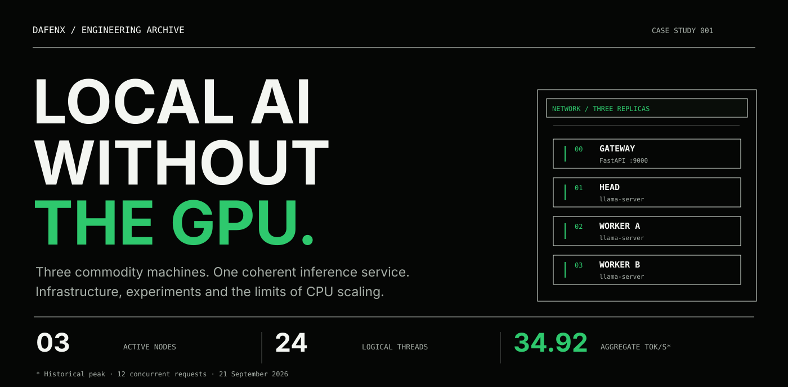
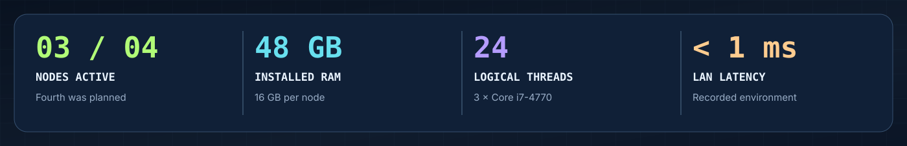
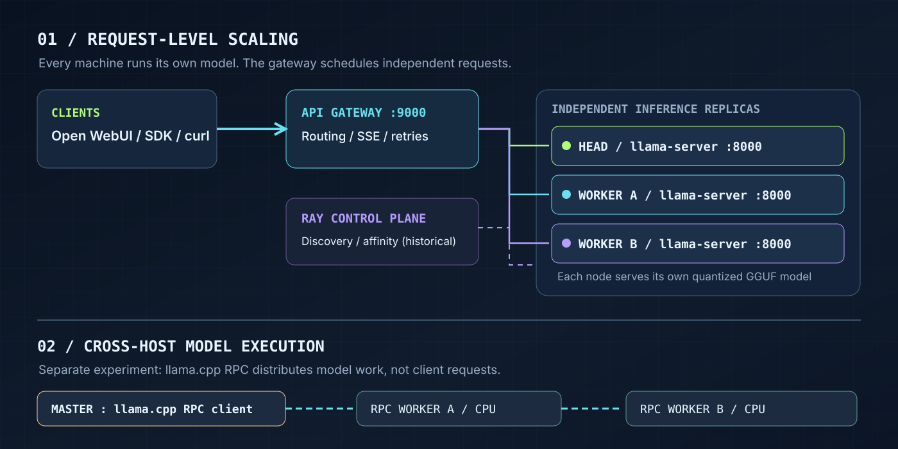
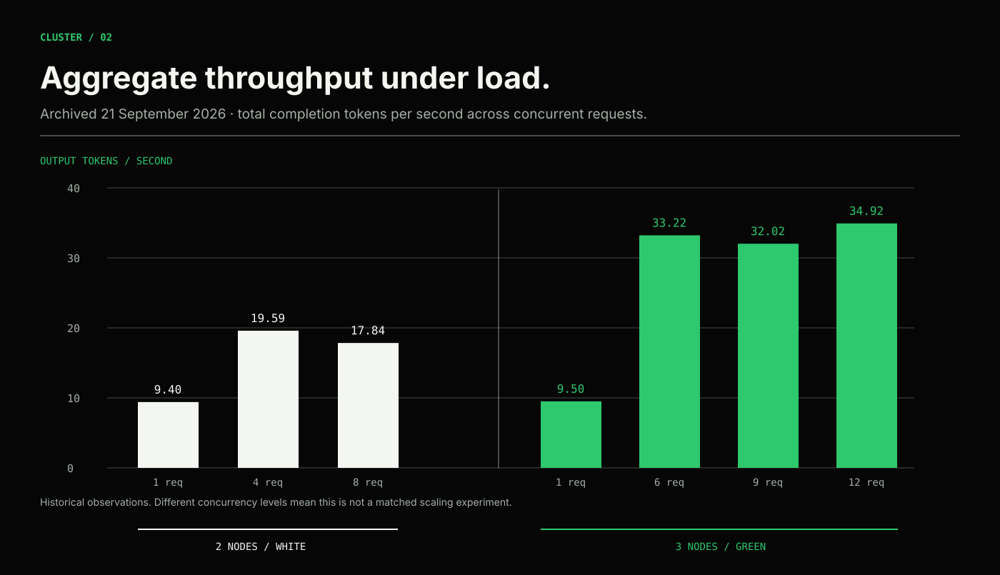
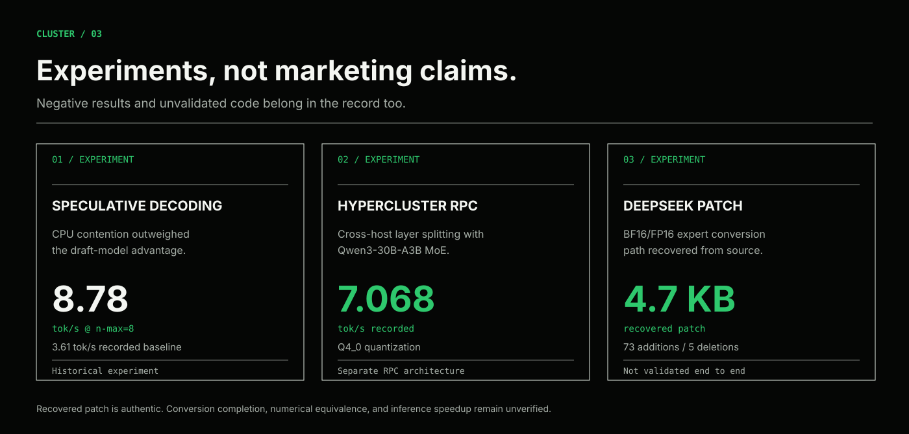
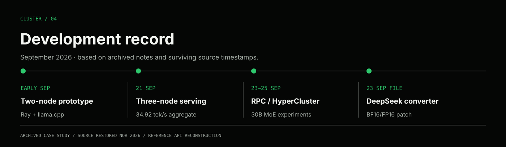

<div align="center">


**Tres PC antiguos, una infraestructura local de IA.**

[English](README.md) · [Arquitectura](#arquitectura) · [Rendimiento](#resultados) · [Experimentos](#experimentos) · [Ejecutar demo](#reproducir-la-api-de-ejemplo)
</div>

> [!NOTE]
> The six SVG visuals in `assets/cluster/` were redesigned as a monochrome editorial set with white technical linework and dark fluorescent green highlights.

> [!IMPORTANT]
> Este repositorio es **un caso de estudio histórico**. Los resultados se registraron en septiembre de 2026. El código de `api/` se reconstruyó y saneó para enseñar la arquitectura; **no es el archivo exacto del servidor desplegado**. El parche DeepSeek sí se recuperó del experimento original, pero todavía no se ha validado mediante una conversión completa.

## Qué construí

Desarrollé un clúster de inferencia LLM **CPU-only** con tres equipos Intel Core i7-4770, **16 GB de RAM y 8 hilos lógicos por máquina**, Ubuntu 24.04.1, Ethernet y modelos GGUF cuantizados de la familia Qwen. El objetivo era dar servicio a varios clientes simultáneos sin depender de una GPU dedicada.

El sistema evolucionó de una primera arquitectura con **Ray** y actores fijados a nodos a una **API FastAPI** compatible con solicitudes de tipo OpenAI. También probé el modo router de llama.cpp para servir bajo demanda Qwen2.5-3B y Qwen3-1.7B desde el nodo principal. Se usaban `llama-server` independientes en los nodos y **Open WebUI** como interfaz. También probé recuperación mediante servicios `systemd`, streaming SSE y enrutamiento con reintentos.



## Arquitectura



**Ruta A: peticiones independientes.** Una instancia de llama.cpp por PC, con una API que deriva solicitudes y gestiona fallos. Mejora la **capacidad agregada** bajo concurrencia, no necesariamente la velocidad de una respuesta individual.

**Ruta B: ejecutar un solo modelo entre varios equipos.** En experimentos separados, `llama.cpp RPC` repartía partes del cálculo entre CPU locales y remotas. El coste de comunicación puede anular la ventaja, especialmente con modelos pequeños. Tres PC con 16 GB **no son una única máquina de memoria compartida de 48 GB**.

## Resultados



| Nodos | Solicitudes concurrentes | Tokens/s agregados |
|---:|---:|---:|
| 2 | 1 | ~9,4 |
| 2 | 4 | 19,59 |
| 2 | 8 | 17,84 |
| 3 | 1 | ~9,5 |
| 3 | 6 | 33,22 |
| 3 | 9 | 32,02 |
| **3** | **12** | **34,92** |

**Fecha:** 21 de septiembre de 2026. Son mediciones transcritas de notas históricas: no están incluidos los logs crudos y los escenarios de dos y tres nodos no tienen exactamente la misma concurrencia. Por eso no se puede afirmar un factor exacto de escalabilidad. Más detalles en [`docs/benchmarks.md`](docs/benchmarks.md).

## Experimentos



- **Decodificación especulativa:** Qwen2.5-3B solo llegó a **8,78 tok/s**; con modelo draft y `n-max=8` cayó a **3,61 tok/s** en los ensayos históricos. El consumo de CPU del draft no compensaba.
- **Fusion / RPC:** con LFM2.5-1.2B una prueba en un i7 llegó a **14,50 tok/s**; variantes distribuidas con división por capas registraron aproximadamente **7,55–10,00 tok/s**. Los modos `row` y `tensor` no dieron una ejecución satisfactoria en esos ensayos.
- **HyperCluster 30B:** se ensayó Qwen3-30B-A3B-Instruct-2507 en Q4_0 (aprox. **16,42 GiB**), con un mejor registro histórico de **7,068 tok/s** usando RPC, división por capas y ajustes concretos de hilos y reparto. No es comparable directamente con la tabla de solicitudes concurrentes.
- **Parche DeepSeek BF16/FP16:** se recuperó un cambio real de `conversion/deepseek.py` que intenta soportar expertos MoE no cuantizados. Está disponible en [`experiments/deepseek-conversion/`](experiments/deepseek-conversion/), **sin afirmar conversión completa verificada**.

## Lo que aprendí



Ray puede regenerar identificadores de nodo; las configuraciones de contexto y número de slots consumen memoria; el NVMe marcó diferencias en los registros de uso; hacer streaming con recuperación de errores exige separar los fallos previos y posteriores a los encabezados; y un sistema distribuido no mejora automáticamente la latencia. El proyecto fue una experiencia práctica de **sistemas, redes, inferencia local, observabilidad y diagnóstico**.

## Reproducir la API de ejemplo

> [!CAUTION]
> La demo es solo para red local de confianza. No tiene autenticación ni TLS: no la expongas a Internet.

Necesitas Python 3.10+ y servidores llama.cpp ya levantados en tu red.

```bash
python3 -m venv .venv
source .venv/bin/activate
pip install -r requirements.txt
cp examples/nodes.example.json nodes.json
# Edita nodes.json con los nodos de TU entorno.
export CLUSTER_NODES_FILE="$PWD/nodes.json"
export CLUSTER_MODEL="your-model-id"
uvicorn api.app:app --host 127.0.0.1 --port 9000
```

```bash
python -m unittest discover -s tests -v
python -m compileall -q api legacy scripts
bash -n scripts/*.sh
```

Los datos de [`observations.csv`](assets/cluster/observations.csv) son una transcripción de las mediciones antiguas para reproducir el gráfico, **no logs crudos**. Los servidores originales, claves y modelos no están incluidos. El cuarto nodo fue planificado, **no contabilizado como desplegado**.

[Volver al README principal](README.md) · [Código de referencia](api/) · [Seguridad](docs/security.md) · [Parche experimental](experiments/deepseek-conversion/)
