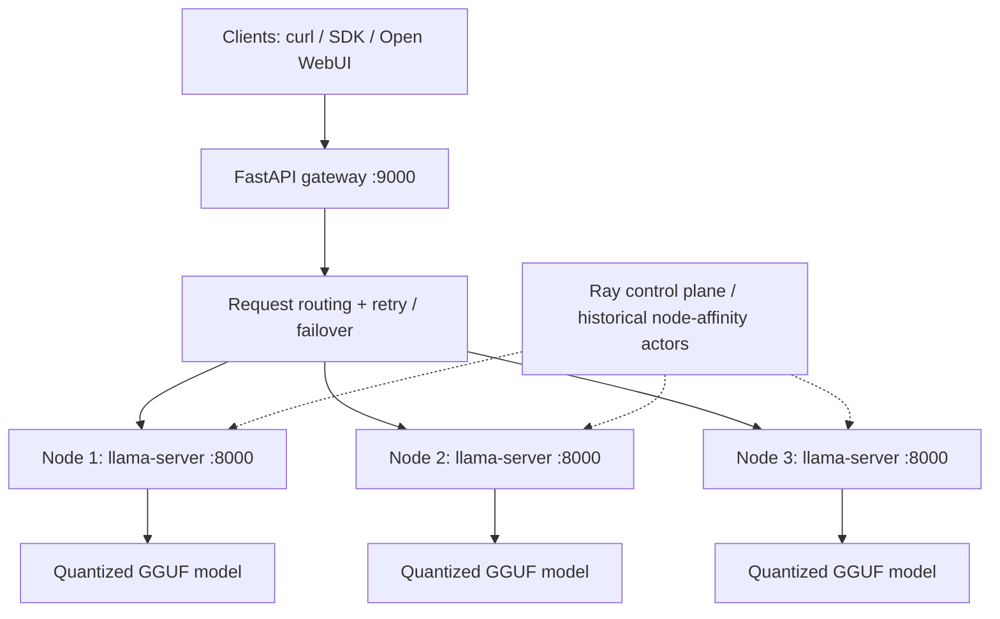

# CPU-Only Local LLM Cluster

**Distributed LLM inference on commodity PCs without discrete GPUs.** A hands-on systems project exploring orchestration, CPU inference, concurrency, observability and infrastructure trade-offs.

> **Repository status:** Portfolio reconstruction based on archived project notes and a retained experimental script from September 2026. The documentation records previously observed experiments. The code in `api/` is a cleaned, independently written reference implementation, **not a byte-for-byte copy of the original deployment**. It has not been retested on the original machines. No private hostnames, model weights or access credentials are included.

## At a glance

| Item | Recorded configuration |
|---|---|
| Hardware | 3 active PCs; 4th planned |
| Per PC | Intel Core i7-4770 (4 cores / 8 threads), 16 GB RAM |
| Operating system | Ubuntu 24.04.1 LTS |
| Accelerators | No discrete GPUs |
| Inference | `llama.cpp`, 4-bit GGUF models (Qwen 1.7B / 3B family) |
| Orchestration | Ray 2.58.0 for node discovery/worker placement in the earlier stage; HTTP request routing for the later gateway |
| API | FastAPI-compatible gateway on port `9000`; inference servers on port `8000` |
| Interface | Open WebUI, formerly on port `3000` |
| Experimental path | `llama.cpp` RPC for a single inference using multiple hosts, kept separate from request-level balancing |

## Architecture



**Scaling model:** For the primary architecture, each node runs its own model instance and handles independent requests. This improves *aggregate concurrent throughput*, not the token rate of one answer. The separate `llama.cpp` RPC experiment explores cross-machine model execution; it is **not** the source of the gateway throughput figures below.

## Results recorded on 21 September 2026

Measurements from project notes, using a quantized 3B-family model, without background load. Throughput denotes **aggregate generated tokens per second across concurrent requests**, not the speed of a single sequence.

| Nodes | Concurrent requests | Aggregate generation throughput |
|---:|---:|---:|
| 2 | 1 | ~9.4 tok/s |
| 2 | 4 | 19.59 tok/s |
| 2 | 8 | 17.84 tok/s |
| 3 | 1 | ~9.5 tok/s |
| 3 | 6 | 33.22 tok/s |
| 3 | 9 | 32.02 tok/s |
| 3 | 12 | 34.92 tok/s |

These are archived measurements, **not independently rerun by this repository**; see [benchmark notes](docs/benchmarks.md) for methodology and limits. In particular, no claims are made about statistical confidence, energy efficiency or performance versus GPU inference.

## What I built and investigated

- Assembled and operated a LAN-based CPU inference setup using repurposed workstations.
- Deployed per-node `llama-server` instances with small quantized models.
- Experimented with Ray and `NodeAffinitySchedulingStrategy` to schedule worker actors on specific hosts; discovered that Ray node IDs may change across restarts.
- Implemented an OpenAI-style API and explored request scheduling, retries, concurrent requests, streaming SSE, and node health.
- Benchmarked throughput under concurrency and evaluated CPU threading, OpenBLAS, model size, storage and scheduling choices.
- Explored a separate experimental RPC setup with SSH forwarding and `llama.cpp` distributed execution; it was not the primary measured architecture.

## Repository tour

```text
cluster/
├── api/                         # Sanitized reference API gateway
│   ├── app.py
│   ├── balancer.py
│   └── config.py
├── docs/
│   ├── architecture.md          # Architecture, trade-offs and history
│   ├── benchmarks.md            # Recorded results and caveats
│   └── security.md              # Safety considerations and publication policy
├── examples/nodes.example.json # Fictional LAN addresses only
├── legacy/ray_worker_reference.py
├── scripts/
│   ├── benchmark.py
│   ├── start_llama_server.sh
│   └── cluster-rpc-experimental.sh
├── tests/test_balancer.py
├── requirements.txt
└── .gitignore
```

## Quick start (reference gateway)

Requires Python 3.10+ and running `llama-server` instances on the configured nodes.

```bash
python -m venv .venv
source .venv/bin/activate
pip install -r requirements.txt
cp examples/nodes.example.json nodes.json
# Edit nodes.json to use your own private LAN addresses.
export CLUSTER_NODES_FILE="$PWD/nodes.json"
export CLUSTER_MODEL="your-model-id"
uvicorn api.app:app --host 127.0.0.1 --port 9000
```

The example IP addresses are documentation placeholders and will not connect to the original infrastructure.

```bash
curl http://127.0.0.1:9000/health
curl http://127.0.0.1:9000/cluster/status
curl http://127.0.0.1:9000/v1/models
curl -X POST http://127.0.0.1:9000/v1/chat/completions \
  -H 'Content-Type: application/json' \
  -d '{"model":"your-model-id","messages":[{"role":"user","content":"Hi"}],"max_tokens":64}'
```

The gateway supports non-streaming and streaming requests, best-effort failover before a stream starts, and a `cluster_node` field on non-streaming JSON replies. It is a **reference implementation** and has no authentication, quotas, or production-grade security controls.

## Running tests

```bash
python -m unittest discover -s tests -v
python -m compileall -q api legacy scripts
bash -n scripts/*.sh
```

## Scope and limitations

- No data, tokens, SSH credentials, institutional hostnames, or GGUF model files are provided.
- The benchmark numbers are from archived notes, not an attached raw benchmark dataset.
- The RPC script is a sanitized **experimental historical artifact**. Do not run it without reading its warnings and adapting paths and services to your own hosts.
- The fourth workstation was planned, **not represented as deployed**.
- The project concerns inference, not training a large model from scratch.

**Context:** Built as an independent practical exploration of affordable local AI systems, orchestration and reliability under constrained hardware.
