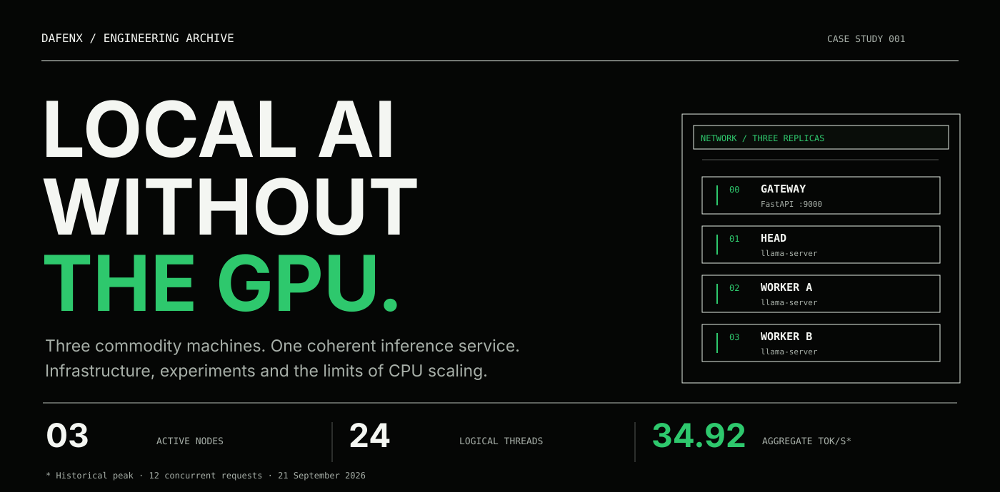
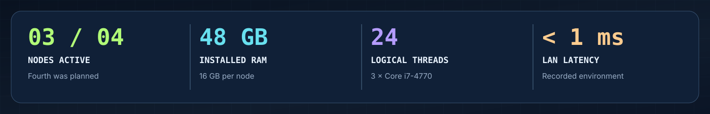
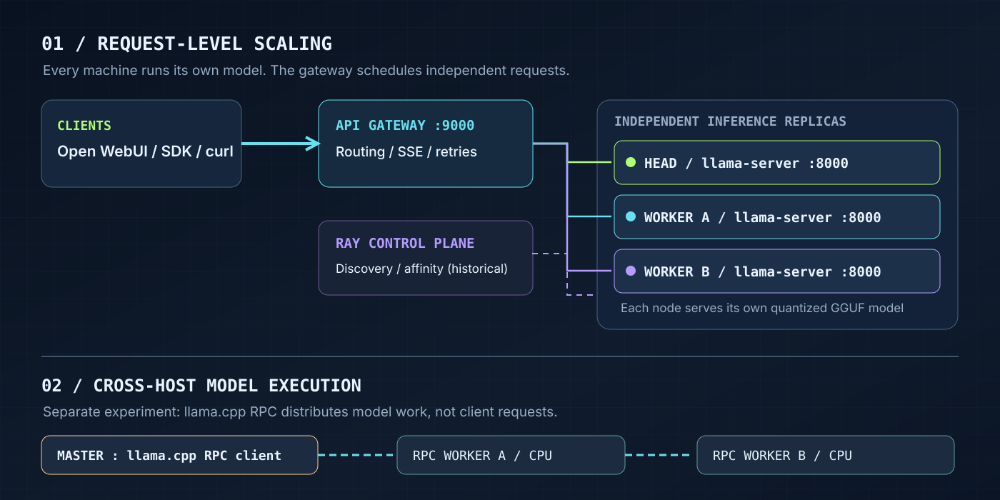
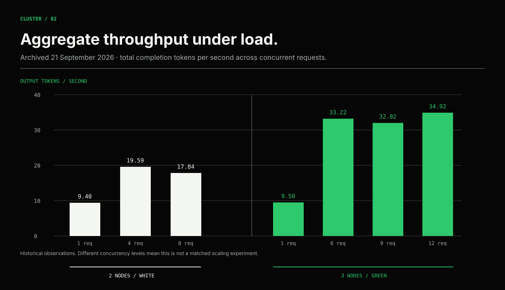
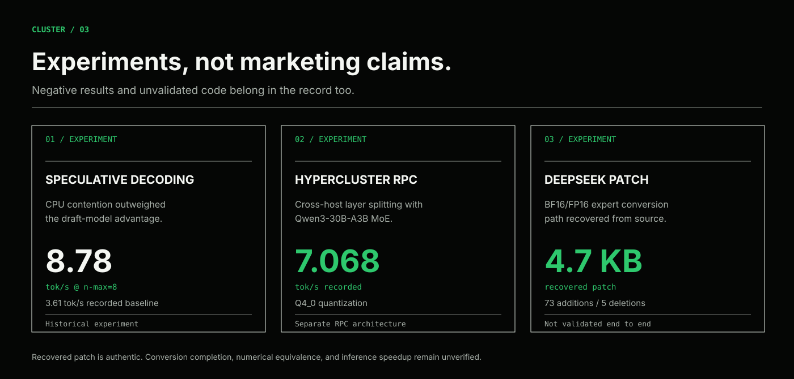
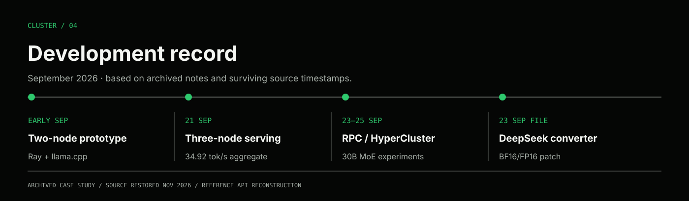

<div align="center">
  # Cluster of local LLMs without a GPU
  

  <p>
    <strong>Making local AI useful on yesterday's hardware.</strong><br/>
    Three repurposed desktops. A real API. Two distinct approaches to distributed inference. Lots of trade-offs.
  </p>

  <p>
    <a href="#architecture"><b>Architecture</b></a> &nbsp;·&nbsp;
    <a href="#benchmarks"><b>Benchmarks</b></a> &nbsp;·&nbsp;
    <a href="#experiments"><b>Experiments</b></a> &nbsp;·&nbsp;
    <a href="#run-the-reference-gateway"><b>Run it</b></a> &nbsp;·&nbsp;
    <a href="#evidence-and-reproducibility"><b>Evidence</b></a> &nbsp;·&nbsp;
    <a href="README.es.md"><b>Español</b></a>
  </p>

  <p>
    
    
    
    
    
    
  </p>
</div>

> [!IMPORTANT]
> **This is an archived systems case study, not a running public inference service.** The September 2026 measurements come from retained project notes. The `api/` code is a **sanitized reference reconstruction**, not the exact original deployment; the recovered DeepSeek patch is real but **not validated end-to-end**. No weights, credentials, institutional hostnames or private infrastructure details are published.

## The idea

**What happens when you cannot buy an inference GPU, but you have a room full of ordinary PCs?**

I built a CPU-only local LLM environment using existing machines, quantized GGUF models, `llama.cpp`, Ray, FastAPI and Open WebUI. It grew from a two-machine experiment into a three-node LAN cluster with a single chat-completions endpoint, health checks, streaming, retries and operational recovery. Later, I investigated a harder question: whether the machines could **cooperate on one larger model** instead of merely serving different requests.

The point wasn't to claim that a cluster of Haswell CPUs beats a modern GPU. It was to learn where distributed systems help, where they introduce overhead, and how to measure the difference.



| Recorded setup | Details |
| :-- | :-- |
| **Machines** | 3 active Intel Core i7-4770 desktops; 4th planned, **never included in the recorded benchmark** |
| **Per node** | 4 physical cores / 8 threads, 16 GB RAM, Ubuntu 24.04.1 LTS |
| **Memory** | 48 GB installed **across three independent hosts**, not a single shared-memory pool |
| **Storage + network** | NVMe for weights and builds; Ethernet LAN with historically recorded latency below 1 ms |
| **Inference** | `llama.cpp`, CPU-only, Qwen-family quantized GGUF models |
| **Serving** | Central FastAPI gateway, per-node inference servers, Open WebUI |
| **Orchestration** | Ray actors / node affinity explored during the original build; later HTTP gateway with node routing |

## Architecture



### Path A · Scale **requests**, not a single answer

The main deployment used **one model replica per node**. Clients sent OpenAI-style requests to the gateway; the gateway routed them to independent `llama-server` instances. This can increase **aggregate throughput under concurrent demand**, but it does not make one completion three times faster.

- `:3000` — Open WebUI on the head node, acting as a client.
- `:9000` — FastAPI entry point with chat completions, health/status, model listing, SSE streaming and retry behavior.
- `:8000` — `llama-server` on each active node.
- Ray — earlier node discovery and `NodeAffinitySchedulingStrategy` for worker placement; node identifiers required rediscovery after restarts.
- `systemd` and health-check timers — historical service restart and recovery automation.
- **Multi-model router mode** on the head in a later stage: Qwen2.5-3B and Qwen3-1.7B aliases loaded on demand (`--models-max 2`), including experiments with an agent-oriented CLI. These archived configurations are not reproduced in `api/`.

The deployed historical gateway used **round-robin and fallback**. The downloadable `api/` reference in this repository instead uses **least-busy scheduling with rotated ties**. They are not presented as the same implementation; see [architecture history](docs/architecture.md).

### Path B · Split **one model** across machines

A separate `llama.cpp` **RPC** track investigated execution with local and remote CPU backends, layer splitting and cross-host model placement. Here the network is on the *inference path*, and its overhead can overwhelm the gain for smaller models. This is a different architecture from Path A, with different performance metrics.

**Three independently hosted 16 GB machines are not equivalent to one 48 GB shared-memory machine.** RPC placement, backend support, transfer costs and memory headroom still matter.

## Benchmarks



The numbers below are **total generated tokens per elapsed second across simultaneous requests**, **not tokens per second per user**. They were recorded on **21 September 2026**, without background load, for a quantized Qwen 3B-family model. Different concurrency levels were used in the two configurations.

| Active nodes | Parallel requests | Aggregate generation, tok/s |
| ---: | ---: | ---: |
| 2 | 1 | ~9.4 |
| 2 | 4 | 19.59 |
| 2 | 8 | 17.84 |
| 3 | 1 | ~9.5 |
| **3** | **6** | **33.22** |
| **3** | **9** | **32.02** |
| **3** | **12** | **34.92** |

**Reading the result:** concurrency helped overall serving capacity. The fastest recorded *aggregate* rate was **34.92 tok/s** with 12 concurrent requests on three nodes. Since node counts were **not compared at identical concurrency settings**, these records do **not** establish a precise linear scaling factor. Raw request-level logs, repeated trials and confidence intervals are not included.

See [benchmark methodology, limitations and a reproducibility plan](docs/benchmarks.md). A normalized data table used to draw the figure is included in [`assets/cluster/observations.csv`](assets/cluster/observations.csv); it is **a transcription of archival notes**, not raw telemetry.

## Experiments



### 01 / Speculative decoding was *slower*

A Qwen2.5-3B target was paired with a Qwen2.5-0.5B draft model to test speculative decoding on limited CPU cores:

| Recorded mode | Generation speed |
| :-- | --: |
| Target alone | **8.78 tok/s** |
| Speculative, `n-max=8` | **3.61 tok/s** |
| Speculative, `n-max=4`, draft thread 1 | **~5–6 tok/s** |

In this setting, the draft model competed for scarce CPU time with the target. **An optimization that works on one hardware class can regress badly on another.** This is a historic exploratory comparison, not a generalized claim about speculative decoding.

### 02 / Fusion and HyperCluster: RPC cost vs. model capacity

Experiments with `llama.cpp` RPC and a small LFM2.5-1.2B model exposed the network/placement overhead of distributing execution. A single-machine recorded test reached **14.50 tok/s**, while exploratory RPC layer-split cases were around **7.55–10.00 tok/s** under their respective settings. `row` split failed and `tensor` split stalled in the recorded experiments. These are **different execution settings**, not a formal performance suite.

For a larger **Qwen3-30B-A3B-Instruct-2507 MoE** model (Q4_0, approximately **16.42 GiB**), the experimental three-host HyperCluster track recorded a best output rate of **7.068 tok/s**, using RPC layer placement (`ngl=46`, split `4/3`, four master threads). This is a **historical observation from the original session**, not a rerun or a performance guarantee. [The recovered HyperCluster launcher and benchmark sweep](#evidence-and-reproducibility) are not part of the public executable demo; the figures should not be compared directly to the 3B gateway table.

### 03 / DeepSeek BF16/FP16 expert conversion patch

A recovered modification against `llama.cpp` commit `543158132` experiments with conversion of *some DeepSeek-V4-format mini/replica checkpoints* whose routed experts are stored as BF16/FP16 tensors rather than MXFP4 scales. It detects the source path, stacks routed expert projections and maps the merged tensors into GGUF expert slots.

**What it does not prove:** successful full conversion, numerical parity, usable inference, or a speed-up. The original patch and its validation checklist are published under [`experiments/deepseek-conversion/`](experiments/deepseek-conversion/).

## Engineering lessons



| What went wrong / changed | What I learned |
| :-- | :-- |
| **Ray node identifiers changed on restart** | Discover live node IDs dynamically; don't assume affinity identifiers are permanent. |
| **Model loading and storage became bottlenecks** | Placement on NVMe and quantized weights mattered under tight memory and disk constraints. |
| **Concurrency competed with latency** | Measure both throughput for all clients and latency for one client; they are not the same metric. |
| **Small models paid an RPC overhead** | More machines can mean more synchronization and network cost, not more speed. |
| **Speculative decoding regressed** | Benchmark proposed optimizations on the real target CPU before adopting them. |
| **Service/process drift after restarts** | Prefer managed services, status endpoints and controlled recovery instead of relying on a shell session. |
| **Proxy settings interfered with local requests** | Separate local traffic from network egress configuration; avoid publishing environment-specific settings. |
| **A converter assumed an expert tensor format** | Treat model-format assumptions as explicit hypotheses; preserve patches and validation plans. |

## Run the reference gateway

> [!CAUTION]
> **Local trusted networks only.** This is a developer reference, not a hardened public LLM endpoint. It lacks authentication, TLS termination, quotas and abuse controls. The original machines and their model weights are not included.

Requirements: **Python 3.10+** and one or more **already running** `llama-server` instances, each serving a compatible model on your own network.

```bash
python3 -m venv .venv
source .venv/bin/activate
pip install -r requirements.txt
cp examples/nodes.example.json nodes.json
# Edit nodes.json: use addresses of YOUR inference servers.
export CLUSTER_NODES_FILE="$PWD/nodes.json"
export CLUSTER_MODEL="your-model-id"
uvicorn api.app:app --host 127.0.0.1 --port 9000
```

Health and chat endpoints:

```bash
curl http://127.0.0.1:9000/health
curl http://127.0.0.1:9000/cluster/status
curl http://127.0.0.1:9000/v1/models

curl -X POST http://127.0.0.1:9000/v1/chat/completions   -H 'Content-Type: application/json'   -d '{"model":"your-model-id","messages":[{"role":"user","content":"Hello from the cluster"}],"max_tokens":64}'
```

The reference also supports SSE streaming and best-effort failover **before** a stream starts. An upstream error **after** streaming starts cannot be seamlessly replayed without altering the client's output semantics.

### Tests

```bash
python -m unittest discover -s tests -v
python -m compileall -q api legacy scripts
bash -n scripts/*.sh
```

## Repository map

```text
Cluster/
├── README.md                        ← This case study
├── README.es.md                     ← Spanish version
├── assets/cluster/                  ← Original SVG diagrams and chart data
│   ├── hero.svg
│   ├── overview.svg
│   ├── architecture.svg
│   ├── benchmarks.svg
│   ├── experiments.svg
│   ├── timeline.svg
│   └── observations.csv
├── api/                             ← Sanitized reference gateway
├── examples/nodes.example.json     ← Fictional addresses for local setup
├── legacy/ray_worker_reference.py  ← Earlier Ray actor architecture sketch
├── scripts/                         ← Benchmark probe and historic RPC experiment
├── tests/                           ← Reference gateway tests
├── experiments/deepseek-conversion/ ← Recovered BF16/FP16 converter patch
└── docs/                            ← Architecture, benchmarks, project history and security
```

## Evidence and reproducibility

| Evidence class | What is available | Important boundary |
| :-- | :-- | :-- |
| **Recovered original artifact** | [`deepseek-bf16-mini.patch`](experiments/deepseek-conversion/deepseek-bf16-mini.patch) | Original changed lines; **no passing full-model conversion is claimed**. |
| **Sanitized historical script** | [`scripts/cluster-rpc-experimental.sh`](scripts/cluster-rpc-experimental.sh) | The script describes an experimental setup; it is not a plug-and-play installer. |
| **Archived measurements** | [`docs/benchmarks.md`](docs/benchmarks.md) and [`observations.csv`](assets/cluster/observations.csv) | Transcribed from notes; no raw benchmark traces attached. |
| **Reconstructed code** | [`api/`](api/) and [`legacy/ray_worker_reference.py`](legacy/ray_worker_reference.py) | Illustrative reference implementations, not identical to the deployed source. |
| **Historical configuration** | [`docs/architecture.md`](docs/architecture.md) | Sanitized service topology and versions, not current uptime. |

**Upstream acknowledgements:** [llama.cpp](https://github.com/ggml-org/llama.cpp), [Ray](https://github.com/ray-project/ray), [FastAPI](https://github.com/fastapi/fastapi), [Open WebUI](https://github.com/open-webui/open-webui). Model artifacts and upstream code are not redistributed by this README.

**Author:** [Dafenx](https://github.com/Dafenxz0) · Built and explored during **September 2026** · README and visual diagrams prepared as a historical project presentation.

<div align="center">
  <sub><b>Build. Measure. Break assumptions. Write down what happened.</b></sub>
</div>
